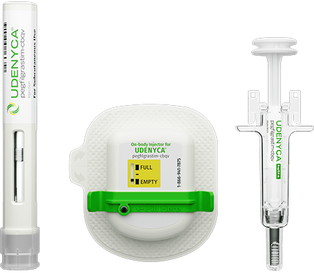

## Udenyca HCP Homepage Hero Image ##
### Problem ###
The hero image appears blurry on high-dpi screens because it is not configured to support responsive high-dpi image rendering.

### Solution ###
Configure the image with the included multiple responsive sizes and allow the browser to select the most appropriate image to load for the users device

### Example Usage ###
```
<!-- Ling tag supporting preloading of responsive high-dpi images (optional, suggested for hero image) -->
<link rel="preload"
      fetchpriority="high"
      as="image"
      href="cmp_family_E_Empty_noBG_v004_456x397__1x_optimized.png"
      imagesrcset="cmp_family_E_Empty_noBG_v004_456x397__1x_optimized.png 456w,
                   cmp_family_E_Empty_noBG_v004_912x794__2x_optimized.png 912w,
                   cmp_family_E_Empty_noBG_v004_1368x1191__3x_optimized.png 1368w"
      imagesizes="(max-width: 456px) 100vw, 456px">


<!-- Image tag supporting responsive high-dpi -->

```

## Udenyca HCP Homepage Tile: Stable Pricing Image ##
### Problem ###
1. The width of the image is fixed at `5rem`, which artificially scales the image horizontally to `80px` (width). Additionally, due to the `height: auto` property, the image then scales vertically to `80px`. The image's original dimensions are `88px x 88px`.
2. The image appears blurry on high-dpi screens because it is not configured to support responsive high-dpi image rendering.

### Solution 1 ###
Both of the above the above issues can be addressed by using the included `icon_stable-pricing_GN.svg` SVG / vector asset.

### Example Usage ###
```

```


Wordpress can be configured to allow SVG images by setting the following:
```
# functions.php

function cc_mime_types($mimes) {
  $mimes['svg'] = 'image/svg+xml';
  return $mimes;
}
add_filter('upload_mimes', 'cc_mime_types');

```

### Solution 2 ###
- Configure the image with the included multiple responsive sizes and allow the browser to select the most appropriate image to load for the users device

### Example Usage ###
```

```

## Udenyca HCP Homepage Tile: Broad Insurance Image ##
### Problem ###
The image appears blurry on high-dpi screens because it is not configured to support responsive high-dpi image rendering. This is particularly apparent on mobile devices.

### Solution 1 ###
This issue can be addressed by using the included `icon_coverage_YW.svg` SVG / vector asset.

### Example Usage ###
```

```


Wordpress can be configured to allow SVG images by setting the following:
```
# functions.php

function cc_mime_types($mimes) {
  $mimes['svg'] = 'image/svg+xml';
  return $mimes;
}
add_filter('upload_mimes', 'cc_mime_types');

```

### Solution 2 ###
- Configure the image with the included multiple responsive sizes and allow the browser to select the most appropriate image to load for the users device

### Example Usage ###
```

```


## Asset Size Comparison Tables ##

### Udenyca HCP Homepage Hero Image ###
| Asset                                                    | File Size |
| -------------------------------------------------------- | --------- |
| device-family_001_RESIZED.png (original)                 | 162kb     |
| -------------------------------------------------------- | --------- |
| cmp_family_E_Empty_noBG_v004_456x397__1x_optimized       | 43kb      |
| -------------------------------------------------------- | --------- |
| cmp_family_E_Empty_noBG_v004_912x794__2x_optimized.png   | 150kb     |
| -------------------------------------------------------- | --------- |
| cmp_family_E_Empty_noBG_v004_1368x1191__3x_optimized.png | 297kb     |

### Udenyca HCP Homepage Tile: Stable Pricing Image ###
| Asset                                                    | File Size |
| -------------------------------------------------------- | --------- |
| icon_stable-pricing_GN_RESIZED.png (original)            | 7.1kb     |
| -------------------------------------------------------- | --------- |
| icon_stable-pricing_GN.svg                               | 2.9kb     |
| -------------------------------------------------------- | --------- |
| icon_stable-pricing_GN_80x80__1x_optimized.png           | 1.1kb     |
| -------------------------------------------------------- | --------- |
| icon_stable-pricing_GN_160x160__2x_optimized.png         | 1.9kb     |
| -------------------------------------------------------- | --------- |
| icon_stable-pricing_GN_240x240__3x_optimized.png         | 2.8kb     |

### Udenyca HCP Homepage Tile: Broad Insurance Image ###
| Asset                                                    | File Size |
| -------------------------------------------------------- | --------- |
| icon_coverage_YW_RESIZED.png (original)                  | 7.1kb     |
| -------------------------------------------------------- | --------- |
| icon_coverage_YW.svg                                     | 1kb       |
| -------------------------------------------------------- | --------- |
| icon_coverage_YW_80x80__1x_optimized                     | 1kb       |
| -------------------------------------------------------- | --------- |
| icon_coverage_YW_160x160__2x_optimized.png               | 1.5kb     |
| -------------------------------------------------------- | --------- |
| icon_coverage_YW_240x240__3x_optimized.png               | 2.2kb     |
